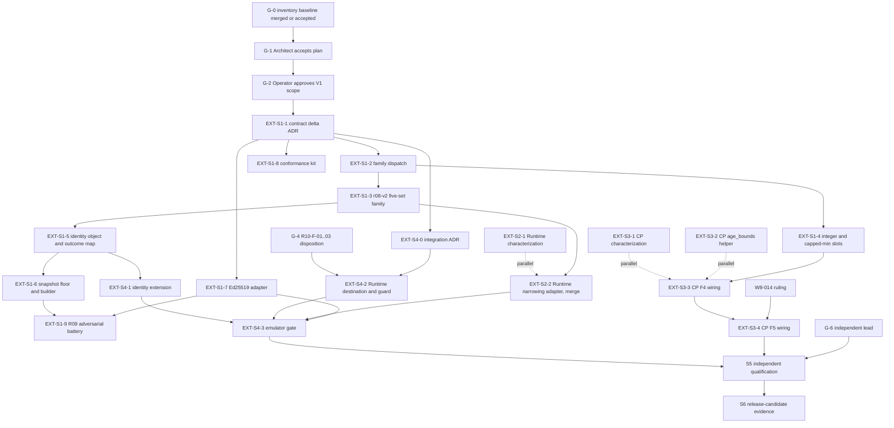

# 5. Contract and integration dependency graph

Status: planning only. Edges below are the dependencies that force order. "S" marks a genuinely serial edge; everything else may overlap. Plan v1.3 section 7 applies throughout: one PR per bounded owner increment, no concurrent edits to canonical contract or activation files.

## Graph

The dotted edges are parallel work: they start without waiting for registry code and merge only after their serial predecessor.

## Serial edges and why

| Edge | Reason |
|---|---|
| G-2 before any implementation PR | The brief: no implementation until the Architect accepts the plan and the operator approves the customer-facing scope |
| `EXT-S1-1` before every code PR | Contract freeze: versioning (`r08-v2`), dispatch contract, identity object, floor, mapping. R10 states no source change can begin before its disposition |
| `EXT-S1-1` then `S1-2`, `S1-5`, `S1-6` | They share `registry_successor/common.py` (CODES), `decision.py`, `verify.py`; plan v1.3 section 7 forbids concurrent edits. `S1-3` follows `S1-2`; `S1-4` slots after `S1-2` |
| `EXT-S1-2` before `EXT-S1-3` and `EXT-S3-3` | The Runtime and Control Plane adapters consume the dispatch table's typed output |
| `EXT-S1-3` (five-set shape frozen) before `EXT-S2-2` merges | Names and empty/absent rules must be frozen; the adapter may be built earlier against a fixture mapping |
| `EXT-S1-4` before `EXT-S3-3` | Typed F4/F5 payload with integer-second slots |
| `EXT-S3-3` (F4) before `EXT-S3-4` (F5) and the W8-014 ruling | The F5 profile change alters `approval_commitment`; approvals must be issued against the effective profile |
| R10-F-03 (exact source candidate) before any Runtime or Control Plane source edit | Heads `c5e97e87`/`7a4bcd40` add terminal approval revocation not present in the S01 pin; any later head change invalidates evidence at the old tuple |
| One owner, one PR for `local_authority_effect.py` and `atomic_local_control_plane_executor.py` | Shared Runtime files; no concurrent S3-era edit |
| `safe_executor.py` never edited | Blob `2fc880da` is the pinned evaluator; an edit forces a re-pin of S01, all records and S05 |
| `EXT-S1-7` (real verifier) before the authenticity claim in `EXT-S4-3` | Until then, authenticity evidence is test-double only (`FakeVerifier`) |
| `EXT-S4-3` and S3 before S5 execution | The gates need something to execute (QG-05, 08, 09, 10 especially) |
| Independent lead (G-6) before S5 non-PREPARE mode | The architect may not self-certify Tier 1 |

## What can run in parallel

| Lane | Starts after | Notes |
|---|---|---|
| `EXT-S2-1` Runtime characterization battery | G-2 | Test-only; needs nothing from the registry; freeze expected values before any adapter code |
| `EXT-S3-1`, `EXT-S3-2` Control Plane characterization and `age_bounds` helper | G-2 and the age rulings | Zero `src/` diff for S3-1; helper has no wiring |
| `EXT-S1-7` Ed25519 adapter, `EXT-S1-8` conformance kit | `EXT-S1-1` | New files only; the lock file is the only shared touch |
| `EXT-S2-2` build against a fixture mapping | `EXT-S1-3` shape known | Merge waits for the freeze |
| `EXT-S4-0` drafting, `EXT-S4-2` destination | `EXT-S1-1`; G-4 for S4-2 | The destination compares identity strings and needs no cryptography |
| `EXT-S5-1` predeclaration (independent author) | G-2 and a designated author | Blind: authored from contract, manifest and source before implementation results |

## Critical path

`G-0, G-1, G-2` then `EXT-S1-1`, `S1-2`, `S1-3`, `S1-5`, `S1-6` (serialized registry core), then the merges of `EXT-S2-2` and `EXT-S3-3`/`S3-4`, then `EXT-S4-3`, then S5 execution, then S6. The Runtime and Control Plane work is off the critical path until its merge point. The longest single risk is serialization of the registry core files, followed by S4's new durable state and its custody review.

## Edges that are not mine to decide

R10-F-01/02/03 (carriage mechanism and exact source candidate) are Architect dispositions. The following are operator items if they arise: whether Route A is in the V1 profile, activation of a mandatory ("required") profile (D7 permits it only as a design capability), and any trust root, key ceremony, production host, publication or production activation.
