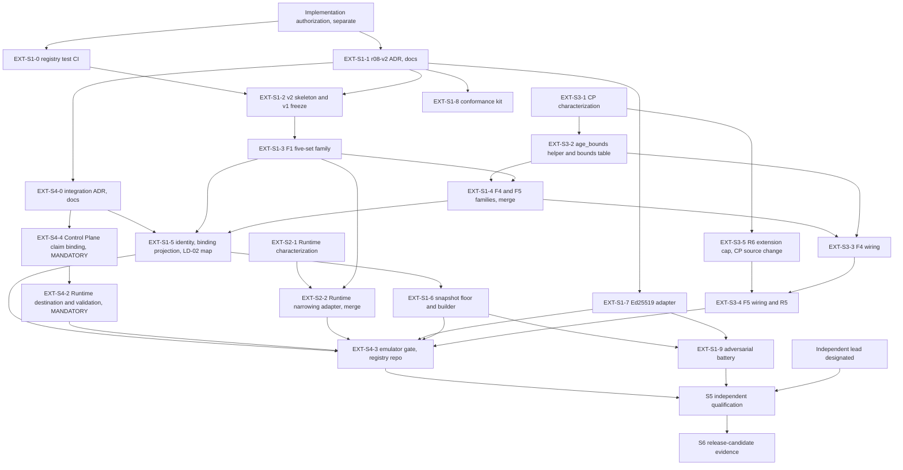

# 5. Contract and integration dependency graph

Status: planning only. Edges below are the dependencies that force order. "Serial" marks an edge that must be honoured; everything else may overlap. Plan v1.3 section 7 applies throughout: one PR per bounded owner increment, one owner per shared enforcement boundary, no concurrent edits to canonical contract or activation files. Rulings R1 to R14 are applied. **Claim-carried policy binding is mandatory (R11): `EXT-S4-4` (Control Plane) and `EXT-S4-2` (Runtime) are on the critical path, in that order.** Release, publication and production stay on HOLD; implementation authorization follows separately.

## Graph

`EXT-S2-G` (confirm required status checks, no code) precedes the first merge in every repository; it is not drawn. `EXT-S3-6` (optional constructor hardening) is outside the minimum graph. `EXT-S4-1` is retired: its content (identity-to-binding projection, digest-profile vector) is absorbed into `EXT-S1-5` so no unnecessary PR remains.

## Serial edges and why

| Edge | Reason |
|---|---|
| Implementation authorization before any implementation PR | The Architect's directive: implementation authorization follows P1 separately |
| `EXT-S1-1` before every registry code PR; `EXT-S4-0` before `EXT-S4-4`, `EXT-S4-2` and `EXT-S1-5` | Contract freeze: `r08-v2` versioning, binding schema, digest profile, closed codes. No source change begins before the ADR is accepted |
| **`EXT-S4-4` (Control Plane) before `EXT-S4-2` (Runtime), mandatory** | The Runtime imports Control Plane claim classes at call time (`local_authority_effect.py:226`, `:791`). Until a Control Plane carrying the successor claim is on the path, the Runtime cannot construct, test or execute a successor claim, and its atomic tests skip silently when `agent_control_plane` is absent. The Runtime PR must therefore fail its own check if the Control Plane pin is absent |
| **`EXT-S4-2` before `EXT-S4-3`** | The gate drives the Runtime destination and must pin its merge commit |
| `EXT-S1-2` before `S1-3`..`S1-6`; `S1-3` then `S1-4` then `S1-5` then `S1-6` | They share `v2_dispatch.py`, `v2_compose.py`, `v2_decision.py`, `v2_verify.py`; no concurrent edits |
| `EXT-S3-2` (bounds table) merged before `EXT-S1-4` merges | The registry F4/F5 payloads must carry the code-owned bounds, and no placeholder value may merge |
| `EXT-S1-4` merged before `EXT-S3-3` merges | The host wiring consumes the typed F4/F5 payload shape (it may be built earlier against a fixture) |
| `EXT-S3-5` (R6 cap) before `EXT-S3-4` (F5 wiring) | The F5 effective profile carries the cap flag, and approvals must be issued against that profile (R5) |
| `EXT-S3-3` before `EXT-S3-4` | F5 alters `approval_commitment`; F4 first keeps the first wiring free of approval invalidation |
| `EXT-S1-3` merged before `EXT-S2-2` merges; `EXT-S2-1` merged before `EXT-S2-2` | Five-set names and empty/absent rules must be frozen; expected values must be frozen before adapter code |
| One open source PR at a time on each shared Control Plane file | `bounded.py`, `runtime_authority.py`, the reason registry (`EXT-S3-5`, `EXT-S3-6`) and Control Plane `local_authority_effect.py` (`EXT-S4-4`); each merge re-pins the next |
| One owner for `local_authority_effect.py` and `atomic_local_control_plane_executor.py` in the Runtime | `EXT-S4-2` only; no concurrent edit |
| `safe_executor.py` never edited (R14) | Blob `2fc880da` is the pinned evaluator; an edit forces a re-pin of S01, all records and S05 |
| `EXT-S1-7` (real verifier) before the authenticity claim in `EXT-S4-3` | Until then, authenticity evidence is test-double only |
| `EXT-S4-3` and `S3` and `S1-9` before S5 execution | The gates need something to execute (QG-05, 08, 09, 10, 16 especially) |
| Any merge into a pinned component after the integration tuple is chosen | Re-pin and re-run the affected gates; every artifact bound to the old tuple is re-issued |
| Independent lead before S5 non-PREPARE mode | The Architect may not self-certify Tier 1 |

## What can run in parallel

| Lane | Starts after | Notes |
|---|---|---|
| `EXT-S1-0` registry test CI | implementation authorization | CI configuration only; no source change |
| `EXT-S2-1` Runtime characterization battery | implementation authorization | Test-only; needs nothing from the registry; freezes expected values before adapter code |
| `EXT-S3-1` Control Plane characterization | implementation authorization | Zero `src/` diff |
| `EXT-S3-2` helper | `EXT-S3-1` | New files only; no wiring; also produces the bounds table |
| `EXT-S1-7` Ed25519 adapter, `EXT-S1-8` conformance kit | `EXT-S1-1` | New files only; the lock file is the only shared touch |
| `EXT-S4-0` ADR drafting | `EXT-S1-1` | Docs only |
| `EXT-S4-4` build against a fixture binding | `EXT-S4-0` | Needs no registry code; merges first of the S4 code PRs |
| `EXT-S2-2` build against a fixture mapping | `EXT-S1-3` shape known | Merge waits for the freeze |
| `EXT-S3-5` R6 cap | `EXT-S3-1` | Independent of the registry; one-at-a-time rule on Control Plane files |
| `EXT-S5-1` predeclaration (independent author) | a designated author | Blind: authored from contract, manifest and source before implementation results |

## Critical path

`EXT-S1-1` then `EXT-S4-0`, `EXT-S4-4`, `EXT-S4-2` (the mandatory Control Plane to Runtime chain), joined with the registry chain `S1-2`, `S1-3`, `S1-4` (after `EXT-S3-2`), `S1-5`, `S1-6` at `EXT-S4-3`, then `EXT-S5-4b` and `EXT-S5-6`, then S6. Two chains of roughly equal length meet at the gate: the registry chain (`EXT-S1-1` to `S1-5`) and the Control Plane to Runtime chain (`EXT-S1-1`, `S4-0`, `S4-4`, `S4-2`). The longest single risk is the S4 chain: new durable Runtime state with its custody review, a Control Plane claim change that moves both repositories' heads, and the re-pin every later merge forces. Effort and the calendar estimate are in [06](06-pr-and-sprint-execution-plan.md).

## Edges that are not mine to decide

The Architect decides: the S4-0 ADR choices (digest profile, claim profile URN and member names, closed codes, tenant and operation mapping, digest-only versus sets in the claim, optional hardening H-1), the age constants `AGE_MAX` and any host floor after the owner survey, the LD-02 vocabulary and carrier questions, and any change to the eight-field scope, the atomic-route boundary, authority ownership or an ADR decision. The operator decides: activation of a mandatory ("required") profile (built inactive), any trust root, key ceremony, production host, publication or production activation, new spending, and whether an independent lead can be secured (the single fact escalated if not).
