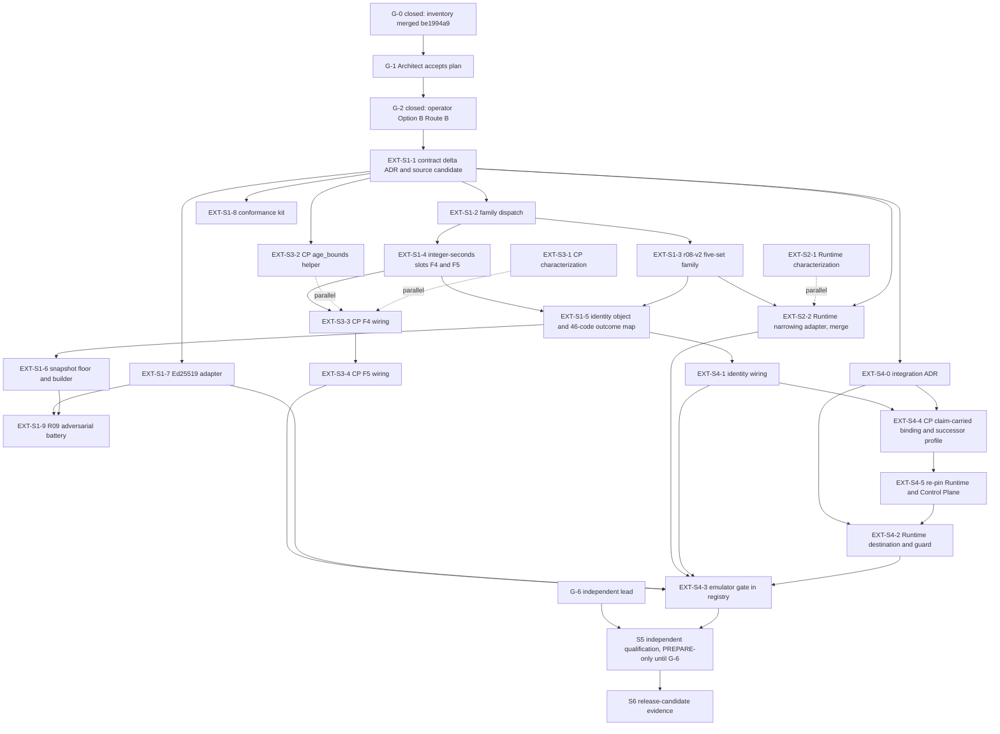

# 5. Contract and integration dependency graph

Status: planning only. Edges below are the dependencies that force order. "S" marks a genuinely serial edge; everything else may overlap. Plan v1.3 section 7 applies throughout: one PR per bounded owner increment, no concurrent edits to canonical contract or activation files.

## Graph

The dotted edges are parallel work: they start without waiting for registry code and merge only after their serial predecessor. `max_amount` has no node: it is deferred.

## Serial edges and why

| Edge | Reason |
|---|---|
| Implementation authorization before any implementation PR | Separate Architect act; merging this plan authorizes no EXT PR |
| `EXT-S1-1` before every code PR | Contract freeze: versioning (`r08-v2`, `r08-v1` behaviour preserved), dispatch contract, identity object (claim-carried), floor, mapping, 46-code outcome map |
| `EXT-S1-1` then `S1-2`, `S1-5`, `S1-6` | They share `registry_successor/common.py` (CODES), `decision.py`, `verify.py`; plan v1.3 section 7 forbids concurrent edits. `S1-3` and `S1-4` follow `S1-2` |
| `EXT-S1-2` before `EXT-S1-3` and `EXT-S3-3` | The Runtime and Control Plane adapters consume the dispatch table's typed output |
| `EXT-S1-3` (five-set shape frozen) before `EXT-S2-2` merges | Names and empty/absent rules must be frozen; the adapter may be built earlier against a fixture mapping |
| `EXT-S1-4` before `EXT-S3-3` | Typed F4/F5 payload with strict-integer-second slots |
| `EXT-S3-3` (F4) before `EXT-S3-4` (F5) | The F5 profile change alters `approval_commitment`; approvals bind to the effective narrowed profile |
| `EXT-S4-0` and `EXT-S1-5` before `EXT-S4-4` | The claim-carried binding needs the identity tuple and the integration ADR (the exact source candidate was already recorded in `EXT-S1-1`) |
| `EXT-S4-4` then `EXT-S4-5` (re-pin) then `EXT-S4-2` | The Runtime guard reads the claim-carried binding, so it can only be built and tested against the re-pinned Control Plane and Runtime |
| `EXT-S1-1` (which records R10-F-03, the exact source candidate) before any Runtime, Control Plane or registry source edit, including `EXT-S2-2` and `EXT-S3-2` | Heads `c5e97e87`/`7a4bcd40` add terminal approval revocation not present in the S01 pin; any later head change invalidates evidence at the old tuple |
| One owner, one PR for `local_authority_effect.py` and `atomic_local_control_plane_executor.py` | Shared Runtime files; no concurrent edit |
| `safe_executor.py` never edited | Blob `2fc880da` is the pinned evaluator; an edit forces a re-pin of S01, all records and S05 |
| `EXT-S1-7` (real verifier) before the authenticity claim in `EXT-S4-3` | Until then, authenticity evidence is test-double only (`FakeVerifier`) |
| `EXT-S4-3` and S3 before S5 execution | The gates need something to execute (QG-05, 08, 09, 10 especially) |
| Independent lead (G-6) before S5 non-PREPARE mode | The architect may not self-certify Tier 1 |

## What can run in parallel, and who owns the shared files

| Lane | Starts after | Owned files (no other lane edits them) |
|---|---|---|
| `EXT-S2-1` Runtime characterization battery | Implementation authorization (merge after `EXT-S1-1` records the candidate) | Runtime `tests/` only; no `src`/`engine` diff |
| `EXT-S3-1` characterization (test-only), `EXT-S3-2` `age_bounds` helper (new source file) | Authorization; `EXT-S3-2` only after `EXT-S1-1` | Control Plane `tests/`; new helper module; no wiring |
| `EXT-S1-7` Ed25519 adapter, `EXT-S1-8` conformance kit | `EXT-S1-1` | New registry modules; the dependency lock is the only shared touch |
| `EXT-S2-2` build against a fixture mapping | `EXT-S1-3` shape known | New Runtime file `engine/local_policy_narrowing.py`; merge waits for the freeze |
| `EXT-S4-0` drafting | `EXT-S1-1` | Registry docs only |
| `EXT-S5-1` predeclaration (independent author, PREPARE) | Authorization and a designated author (or PREPARE-only mode) | Qualification-repo docs/data; blind to implementation results |

Serialized registry core (`common.py`, `decision.py`, `verify.py`, `selection.py`, `compose.py`, `record.py`) belongs to one registry owner at a time across `EXT-S1-2`, `S1-3`, `S1-4`, `S1-5`, `S1-6`, `S4-1`. The two shared Runtime files belong to `EXT-S4-2` alone. The Control Plane claim path belongs to `EXT-S4-4` alone.

## Critical path

`EXT-S1-1`, `S1-2`, `S1-3`/`S1-4`, `S1-5`, `S1-6` (serialized registry core), then `EXT-S4-0`/`S4-1`, `EXT-S4-4`, `EXT-S4-5` (re-pin), `EXT-S4-2`, `EXT-S4-3`, then S5 execution, then S6. The Runtime and Control Plane adapter work (S2, S3) is off the critical path until its merge point at `EXT-S4-3`. The longest single risks are the serialized registry core, the two-repository claim-carried binding with re-pinning, and the new durable state's custody review.

## Edges that are not mine to decide

The exact source candidate (R10-F-03) is an Architect disposition, taken in `EXT-S1-1`. The following are operator items if they arise: activation of a mandatory ("required") profile (D7 permits it only as a design capability), adding `max_amount` or any other family, bringing Route A into scope, and any trust root, key ceremony, production host, publication or production activation.
